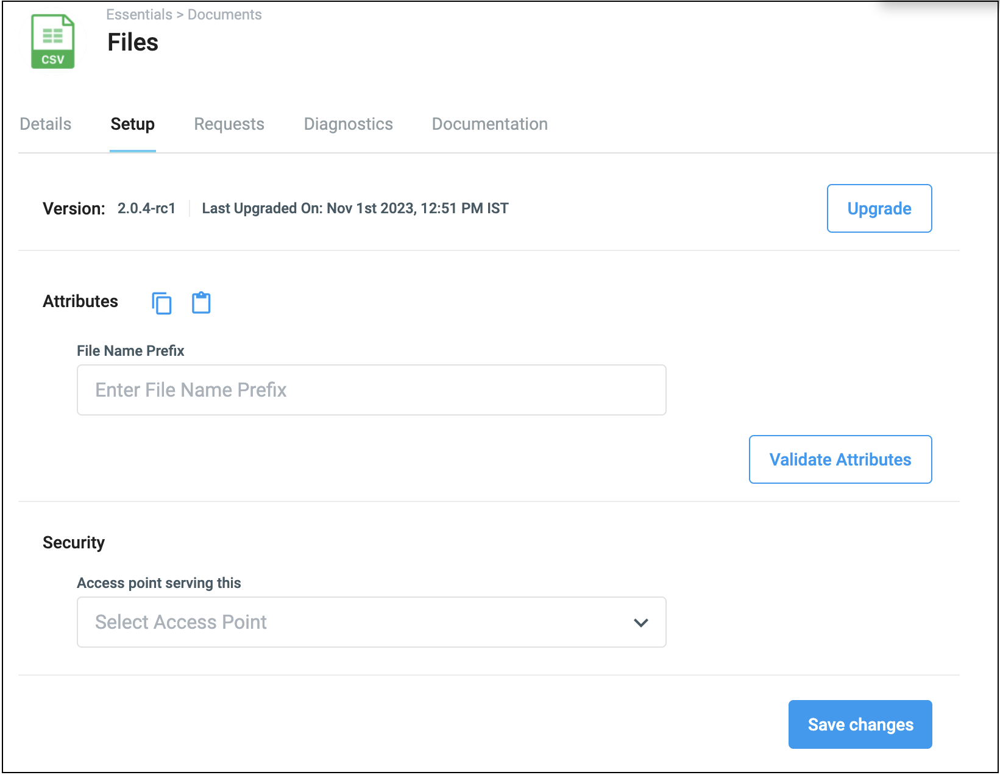

# Configuring Files Extension in Krista

## Steps for Configuration

* To configure the Krista Files Extension, navigate to the setup page.
 

* In the File Name Prefix field, enter the prefix name of file.
* This is the file name that is used for request.
    * For example, Prefix at DD-MM-YYYY HH.MM.SS AM.csv.
* This input field is optional.
* **Important**: File names can only contain letters (A-Z, a-z), numbers (0-9), and periods (.). Special characters and spaces are not allowed.

* On the Diagnosis page, click Test Connection to confirm that the test connection is successful.

* You can proceed to create requests after test connection.

## Troubleshooting Configuration Issues

If you encounter issues during configuration:

1. **Invalid file name error**: Ensure the File Name Prefix contains only allowed characters (letters, numbers, periods)
2. **Test connection fails**: Check your system configuration and contact your administrator
3. **Extension not loading**: Verify the extension is properly installed and enabled

For more detailed troubleshooting information, see the [Troubleshooting Guide](troubleshooting.md).
